---
format:
  revealjs:
    css: style.css
    theme: black
    # Use CSS image sizing; RevealJS stretching can collapse lazy images in scroll view.
    auto-stretch: false
    width: 1280
    height: 720
    margin: 0.03
    transition: fade
    revealjs-plugins:
      - a11y
      - read-aloud
    revealjs-a11y:
      # The extension's menus introduce ARIA failures; retain our slide-menu handling.
      slide-menu-a11y: false
      menu: false
      # Use the extension's core accessibility fixes without extra UI/shortcuts.
      font-size-controls: false
      font-selection: false
      text-spacing: false
      transcript: false
      slide-change-cue: false
    slide-number: true
    code-line-numbers: false
    preview-links: auto
    keyboard: true
    touch: true
    help: true
    include-in-header: meta-tags.html
    include-after-body: accessibility.html
    link-external-newwindow: true
    footer: ""
    highlight-style: github
execute:
  echo: true
  eval: false
keywords: ["claude-code", "ai-agents", "cli", "anthropic", "software-engineering", "best-practices", "hooks", "skills"]
description-meta: "Practical advice for getting reliable work out of Claude Code: tell it what it cannot see, give it a check to run, enforce the rules that cannot bend, change defaults only when they cost too much, and steer the session."
license: "CC0 1.0 Universal"
title: "Effective Claude Code Usage"
# The first slide is the custom title slide; hide the generated one.
title-slide-attributes:
  data-visibility: hidden
pagetitle: "Effective Claude Code Usage"
author-meta: "Indrajeet Patil"
date-meta: "2026-11-22"
lang: "en"
dir: "ltr"
image: "media/social-media-card.png"
image-alt: "Effective Claude Code Usage: practical habits for reliable work with a coding agent, beside the orange Claude spark mark."
canonical-url: "https://www.indrapatil.com/effective-claude-code-usage/"
jupyter: python3
---
## Effective Claude Code Usage {.deck-title}

::: {.title-copy}

::: {.title-subtitle}
Give it context it can't find, a check it can run, and rules it can't bend.
:::

::: {.title-byline}
Indrajeet Patil · 2026 · [Source code](https://github.com/IndrajeetPatil/effective-claude-code-usage/)
:::

:::

::: {.title-art}

::: {.terminal-box data-title="claude"}
<pre><code><span class="tk-prompt">&gt;</span> users report login fails after the
  session times out. look at token
  refresh in src/auth/, write a failing
  test that reproduces it, then fix it

<span class="tk-muted">● Read src/auth/refresh.ts</span>
<span class="tk-muted">● Write tests/refresh.test.ts</span>
<span class="tk-muted">● Bash pnpm vitest run tests/refresh</span>
<span class="tk-ok">  1 failed → fix → 14 passed</span>
</code></pre>
:::

:::

::: {.notes}
Welcome. This talk is not a tour of Claude Code's features. It is about the small number of habits that decide whether a session goes well: telling Claude what it cannot find on its own, giving it a way to check its work, and enforcing the few rules that must never bend.
:::

## Most sessions go wrong in one of four ways {data-eyebrow="Overview"}

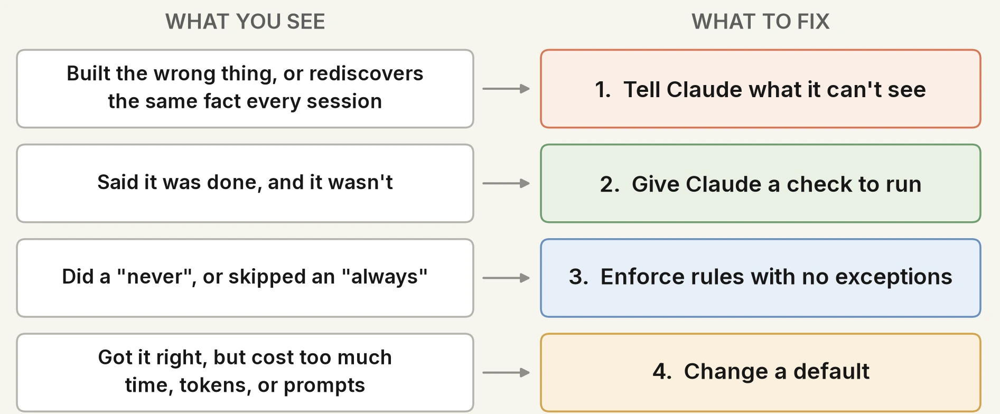{.diagram fig-alt="Four symptoms mapped to fixes. Built the wrong thing, or rediscovers the same fact every session: tell Claude what it can't see. Said it was done and it wasn't: give Claude a check to run. Did a never, or skipped an always: enforce rules with no exceptions. Got it right but cost too much time, tokens, or prompts: change a default."}

::: {.source}
Source: [Best practices for Claude Code](https://code.claude.com/docs/en/best-practices) · checked against v2.1.330
:::

::: {.notes}
When a session disappoints, the cause is almost always one of four things. Claude was missing information it could not get from the repository. It had no way to check its own work. A rule that must always hold was only written down as advice. Or the defaults cost more time or tokens than the task was worth. The rest of this talk takes these four in turn, and then covers steering a session and letting Claude run without you.
:::

## Start with the defaults {data-eyebrow="Overview" .fill-tiles}

::: {.lead}
A plain prompt in a fresh session usually does the right thing. Change a setting only after it costs you something.
:::

::: {.tiles}

::: {.tile}
::: {.tile-heading}
`auto` mode
:::
::: {.tile-text}
Routine commands run without prompts; a classifier blocks risky ones.
:::
:::

::: {.tile}
::: {.tile-heading}
`medium` effort
:::
::: {.tile-text}
The default effort on a capable model: plenty for everyday work.
:::
:::

::: {.tile}
::: {.tile-heading}
Subagents
:::
::: {.tile-text}
Claude delegates broad searches and side tasks on its own.
:::
:::

::: {.tile}
::: {.tile-heading}
Auto-compaction
:::
::: {.tile-text}
Long conversations are summarised before the window fills.
:::
:::

:::

::: {.source}
Source: [Best practices: change a default](https://code.claude.com/docs/en/best-practices#change-a-default)
:::

::: {.notes}
Before you configure anything, know what you already get. New terminal sessions start in auto mode, run a capable model at medium effort, delegate to subagents when there is a reason to, and compact the conversation as it grows. Most advice about micromanaging these is out of date. The setup worth doing is the setup that tells Claude about your project, because no default can know that.
:::

# Tell Claude what it can't see {data-eyebrow="Part 1"}

Claude reads your code faster than you can explain it. Write down only what was never in the repository.

::: {.symptom}
Claude built the wrong thing, or rediscovers the same fact at the start of every session.
:::

::: {.notes}
The first fix is about information. Claude is very good at reading a codebase, so most of what you might be tempted to explain, it already knows. What it cannot know is what was never written down.
:::

## Should this go in `CLAUDE.md`? {data-eyebrow="Part 1 · Context"}

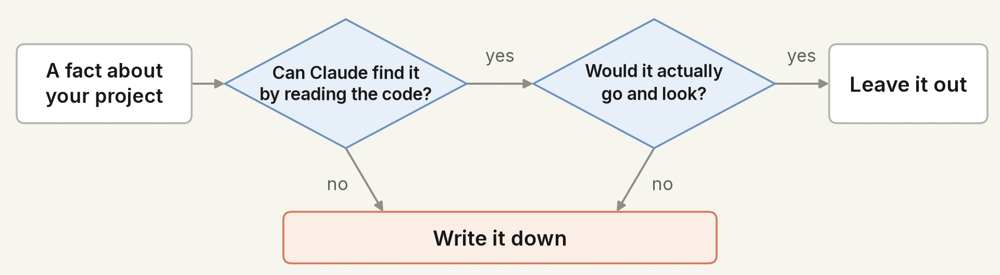{.diagram fig-alt="Decision flow for a fact about your project. If Claude cannot find it by reading the code, write it down. If it can, ask whether it would actually go and look: if yes, leave it out; if no, write it down."}

:::: {.columns}

::: {.column width="50%"}
::: {.card-green .card-compact}
**Write down** · the exact test and lint commands, misleading code to avoid copying, decisions made in meetings, anything you've corrected twice.
:::
:::

::: {.column width="50%"}
::: {.card-subtle .card-compact}
**Keep it short** · start with `/init`, then delete. Aim for under 200 lines; `/doctor` suggests cuts.
:::
:::

::::

::: {.source}
Source: [Best practices: tell Claude what it can't see](https://code.claude.com/docs/en/best-practices#tell-claude-what-it-cant-see)
:::

::: {.notes}
Before you write a line for Claude, ask two questions. Could it find this by reading the code? And would it actually go and look? If both answers are yes, leave it out. Every line in the project instructions file costs a little attention on every task, so the file works best when it holds only commands, traps, and decisions that are not visible in the code.
:::

## Put each fact where it costs least {data-eyebrow="Part 1 · Context"}

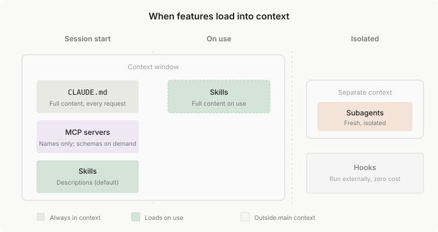{.diagram fig-alt="When features load into context. At session start, CLAUDE.md loads in full on every request, MCP servers load tool names only with schemas on demand, and skills load their descriptions. On use, a skill's full content loads. Isolated: subagents get a fresh separate context, and hooks run externally at zero context cost."}

::: {.card-amber .card-compact}
**Rule of thumb** · a line that only matters in `src/api/` belongs in a `.claude/rules/` file with a `paths:` glob; a procedure, such as a release, belongs in a skill. Turn off MCP servers you don't use.
:::

::: {.source}
Illustration: [Claude Code docs, Extend Claude Code](https://code.claude.com/docs/en/features-overview) · Sources: [Memory](https://code.claude.com/docs/en/memory) · [Skills](https://code.claude.com/docs/en/skills) · [MCP](https://code.claude.com/docs/en/mcp)
:::

::: {.notes}
Not all knowledge belongs in the same file. The main instructions file loads in every session, so keep it for facts that apply everywhere. Rules for one part of the codebase can be scoped to file paths so they only load when Claude works there. Procedures go into skills, whose full text loads only when a task needs it. And systems outside the repository are best reached through their command-line tools, or through an MCP server when no command-line tool exists.
:::

## Say what "done" looks like {data-eyebrow="Part 1 · Context" .fill-compare}

::: {.compare}

::: {.compare-head}
Instead of
:::

::: {.compare-head}
Try
:::

::: {.compare-weak}
fix the login bug
:::

::: {.compare-strong}
users report login fails after the session times out. look at token refresh in src/auth/, write a failing test that reproduces it, then fix it
:::

::: {.compare-weak}
build the settings page
:::

::: {.compare-strong}
build the settings page from the mockup. be ambitious: empty and error states, the save flow wired up, keyboard navigation
:::

:::

::: {.card-blue .card-compact}
**Hand over, don't describe** · `@path` attaches a file, a pasted screenshot shows the design, and `cat error.log | claude -p` pipes in the output.
:::

::: {.source}
Source: [Best practices: write a specific prompt](https://code.claude.com/docs/en/best-practices#write-a-specific-prompt)
:::

::: {.notes}
A specific prompt helps for the same reason: it contains information Claude does not have. Name the file, describe the symptom, and say what fixed looks like. Claude also tends to read a request conservatively and build the smallest thing that satisfies it. If you want the fuller version, saying "be ambitious" tells it about scope, which only you know.
:::

## Unsure what you want? Get interviewed {data-eyebrow="Part 1 · Context"}

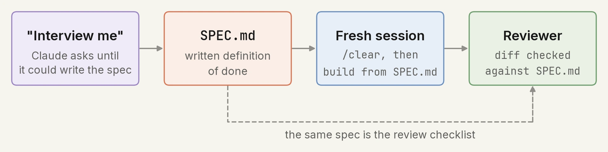{.diagram fig-alt="Four steps. Ask Claude to interview you until it could write the spec. It writes SPEC.md, a written definition of done. Start a fresh session with /clear and build from SPEC.md. A reviewer checks the diff against SPEC.md; a dashed line shows the same spec becomes the review checklist."}

::: {.terminal-box data-title="prompt"}
<pre><code>I want to add rate limiting to the public API but haven't thought it through.
Interview me until you could write the spec, then write it to SPEC.md.</code></pre>
:::

::: {.source}
Source: [Best practices: brainstorm with Claude first](https://code.claude.com/docs/en/best-practices#brainstorm-with-claude-first)
:::

::: {.notes}
When you do not yet know exactly what you want, you do not have to work it out alone. Ask Claude to interview you. It asks multiple-choice questions about the parts you have not decided, and writes the answers into a spec. Then start a fresh session to build from that file, so the build begins with clean context and a written definition of done. Later, the same spec becomes the reviewer's checklist.
:::

# Give Claude a check to run {data-eyebrow="Part 2"}

Without something that returns pass or fail, "looks done" is all Claude has to go on, and you become the test suite.

::: {.symptom}
Claude said it was done, and it wasn't quite.
:::

::: {.notes}
The second fix is about knowing when the work is finished. Claude stops when the work looks done. If nothing tells it whether the work actually is done, every mistake waits until you notice it.
:::

## The loop only ends well with a check {data-eyebrow="Part 2 · Check"}

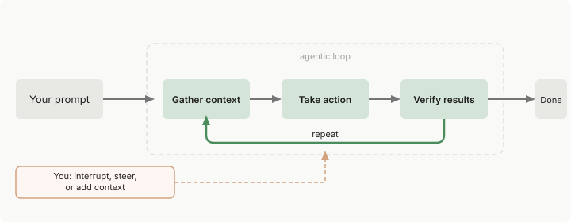{.diagram fig-alt="The agentic loop: your prompt leads to gathering context, taking action, and verifying results, repeating until done. You can interrupt, steer, or add context at any point."}

::: {.card-green .card-compact}
**Verify needs a pass/fail signal** · without one, Claude stops when the work only *looks* done. A test file, a build's exit code, a linter, or a screenshot next to the mockup all work; the most useful line in `CLAUDE.md` is the command that runs it.
:::

::: {.source}
Illustration: [Claude Code docs, How Claude Code works](https://code.claude.com/docs/en/how-claude-code-works) · Source: [Best practices](https://code.claude.com/docs/en/best-practices#give-claude-a-check-to-run)
:::

::: {.notes}
Claude works in a loop: gather context, act, and check. With a check that returns pass or fail, it can close that loop on its own, reading each failure and fixing it before trying again. The check can be almost anything whose result Claude can read. If your repository already has one, put the command that runs it in your project instructions.
:::

## Choose how strictly to hold it {data-eyebrow="Part 2 · Check"}

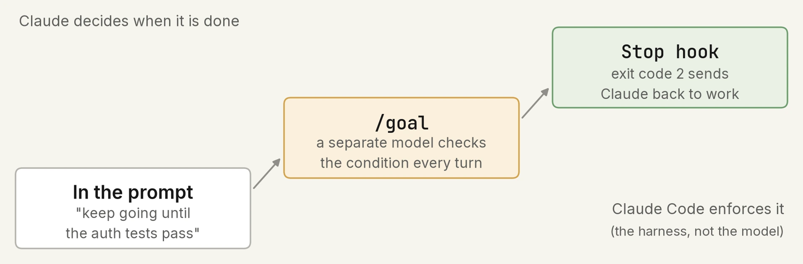{.diagram fig-alt="A three-step ladder from Claude decides when it is done up to Claude Code enforces it. Lowest: in the prompt, such as keep going until the auth tests pass. Middle: /goal, where a separate model checks the condition every turn. Top: a Stop hook, where exit code 2 sends Claude back to work."}

:::: {.columns}

::: {.column width="50%"}
::: {.card-blue .card-compact}
**Ask for evidence** · the command and its output, not "all tests pass". Then `/verify` has Claude run the app and look at the result.
:::
:::

::: {.column width="50%"}
::: {.card-purple .card-compact}
**Get a fresh reviewer** · a subagent that never saw your reasoning: `/code-review`, or one told to check the diff against `SPEC.md` and report correctness gaps.
:::
:::

::::

::: {.source}
Sources: [Best practices](https://code.claude.com/docs/en/best-practices#give-claude-a-check-to-run) · [Review against your spec](https://code.claude.com/docs/en/best-practices#review-against-your-spec) · [`/verify`](https://code.claude.com/docs/en/skills#run-and-verify-your-app) · [`/goal`](https://code.claude.com/docs/en/goal) · [`Stop` hook](https://code.claude.com/docs/en/hooks#stop)
:::

::: {.notes}
You choose how strict the check is. Asking in the prompt works for any task with no setup, but Claude decides when it is satisfied. A goal has a separate model check the condition after every turn, which matters most for long background runs. A Stop hook is enforced by Claude Code itself: when the script fails, Claude is sent back to work. Whichever you choose, ask for evidence, and run verify to have Claude try the app itself. For important work, get a review from a subagent that did not write the code, and have it compare the result against your spec and report only gaps that affect correctness.
:::

## A `Stop` hook makes the check non-negotiable {data-eyebrow="Part 2 · Check"}

```{.json filename=".claude/settings.json"}
{
  "hooks": {
    "Stop": [
      { "hooks": [
          { "type": "command", "command": "pnpm tsc --noEmit 1>&2 || exit 2" }
      ] }
    ]
  }
}
```

:::: {.columns}

::: {.column width="50%"}
::: {.card-green .card-compact}
**How it works** · exit code 2 blocks the stop; stderr goes back to Claude as the reason it can't finish yet.
:::
:::

::: {.column width="50%"}
::: {.card-amber .card-compact}
**Escape hatch** · after eight blocked stops in a row with no tool call, Claude Code ends the turn anyway. Required CI stays the final gate.
:::
:::

::::

::: {.source}
Source: [Best practices: enforce the check with a Stop hook](https://code.claude.com/docs/en/best-practices#enforce-the-check-with-a-stop-hook)
:::

::: {.notes}
Here is the strictest version for a typecheck. When Claude tries to finish, Claude Code runs the compiler. If it fails, the hook exits with code 2, which blocks the stop, and the compiler output goes back to Claude as the reason. A line in the instructions file saying "always typecheck" works most of the time. This runs every time, up to a safety limit on repeated blocks, so keep required checks in CI as the final gate before merging.
:::

# Enforce the rules that can't have exceptions {data-eyebrow="Part 3"}

`CLAUDE.md` is guidance, and Claude may decide a guideline doesn't apply. If something must always or never happen, configure it.

::: {.symptom}
Claude did something that must never happen, or skipped a step that must always happen.
:::

::: {.notes}
The third fix is about rules. Some rules can have exceptions, and Claude is usually well placed to judge them. Others must hold every time, and for those advice is not enough.
:::

## Guidance or enforcement? {data-eyebrow="Part 3 · Enforce"}

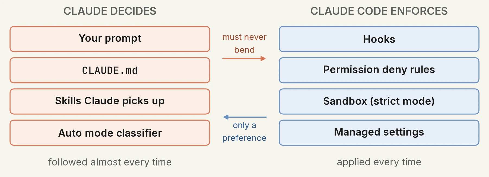{.diagram fig-alt="Two columns. Claude decides: your prompt, CLAUDE.md, skills Claude picks up, and the auto mode classifier; followed almost every time. Claude Code enforces: hooks, permission deny rules, the sandbox in strict mode, and managed settings; applied whatever Claude decides. An arrow moves rules that must never bend to the right; another moves rules that are only preferences to the left."}

::: {.card-amber .card-compact}
**The signal** · if you keep adding IMPORTANT to a `CLAUDE.md` line and Claude still misses it, the line belongs in a hook. If a hook only encodes a preference, delete it.
:::

::: {.source}
Source: [Best practices: deterministic and non-deterministic instructions](https://code.claude.com/docs/en/best-practices#deterministic-and-non-deterministic-instructions)
:::

::: {.notes}
Every instruction is one of two kinds. Prompts, the instructions file, and skills are read by the model, which usually follows them but is not guaranteed to. Hooks, deny rules, the sandbox, and managed settings are applied by Claude Code, whatever the model decides. Most of the time you want Claude to decide. Move a rule into configuration only when it must never bend, and move it back if it turns out to be a preference.
:::

## Two rules, enforced {data-eyebrow="Part 3 · Enforce"}

:::: {.columns}

::: {.column width="50%"}

```{.json filename="Never read secrets"}
{
  "permissions": {
    "ask":  ["Bash(git push *)"],
    "deny": ["Read(./.env)",
             "Read(./secrets/**)"]
  }
}
```

::: {.card-subtle .card-compact}
Deny rules hold in every permission mode and also catch `cat .env`. They match tool calls, not intent: a script that opens the file slips through, so pair them with `/sandbox`.
:::

:::

::: {.column width="50%"}

```{.json filename="Always format after editing"}
{
  "hooks": {
    "PostToolUse": [{
      "matcher": "Edit|Write",
      "hooks": [{ "type": "command",
        "command": "f=$(jq -r '.tool_input.file_path') && npx prettier --write \"$f\"" }]
    }]
  }
}
```

::: {.card-subtle .card-compact}
Claude doesn't have to remember it. A hook that crashes or times out lets the action through unless it sets `"onFailure": "block"`.
:::

:::

::::

::: {.source}
Sources: [Permissions](https://code.claude.com/docs/en/permissions) · [Hooks guide](https://code.claude.com/docs/en/hooks-guide) · [Hook failures](https://code.claude.com/docs/en/hooks#block-the-action-when-a-hook-fails) · [Sandboxing](https://code.claude.com/docs/en/sandboxing)
:::

::: {.notes}
On the left, never reading secrets becomes a deny rule. It applies in every permission mode, and Claude Code also recognises common shell commands that read files. Rules match tool calls rather than intent, so for security, add the operating-system sandbox. On the right, always formatting becomes a hook that runs after every edit. By default, a hook that crashes or times out lets the action go ahead, so a hook that guards a rule should set on-failure to block. You do not have to write these yourself: asking Claude to write a hook that blocks edits to a folder works. Keep the enforced set small, because each rule needs maintenance.
:::

# Change a default when it costs too much {data-eyebrow="Part 4"}

The defaults are good until a task costs more time, tokens, or interruptions than it should. `/usage` shows where it went.

::: {.symptom}
Claude got it right, but it took more time, tokens, or permission prompts than the task was worth.
:::

::: {.notes}
The fourth fix is about cost. When a session uses too much time, too many tokens, or too many permission prompts, one of a few defaults is usually the reason.
:::

## Permission mode: both ends have a cost {data-eyebrow="Part 4 · Defaults"}

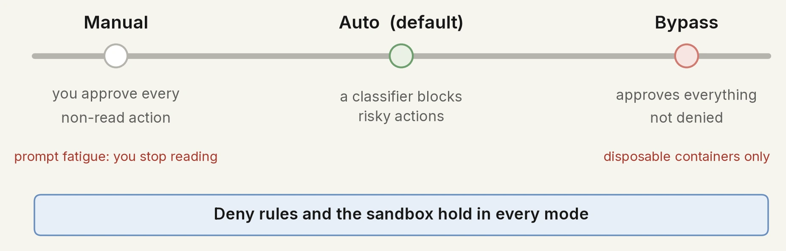{.diagram fig-alt="A permission spectrum. Manual: you approve every non-read action, which leads to prompt fatigue. Auto, the default: a classifier blocks risky actions. Bypass: approves everything not denied; disposable containers only. Below: deny rules and the sandbox hold in every mode."}

::: {.card-blue .card-compact}
**Tune, don't toggle** · `Shift+Tab` cycles modes. If auto keeps blocking routine work, describe your trusted infrastructure in `autoMode`; if manual asks too often, `/fewer-permission-prompts` builds an allowlist.
:::

::: {.source}
Sources: [Permission modes](https://code.claude.com/docs/en/permission-modes) · [Auto mode configuration](https://code.claude.com/docs/en/auto-mode-config)
:::

::: {.notes}
Manual approval sounds safe, but after the tenth prompt people approve without reading. Bypass approves everything that is not denied, which belongs only in a disposable container. Auto mode sits between them and is the default. If it repeatedly blocks something routine in your setup, configure it rather than switching modes. And remember that auto mode is a model's judgement: your never rules still belong in deny rules or hooks.
:::

## Effort, not "think harder" {data-eyebrow="Part 4 · Defaults"}

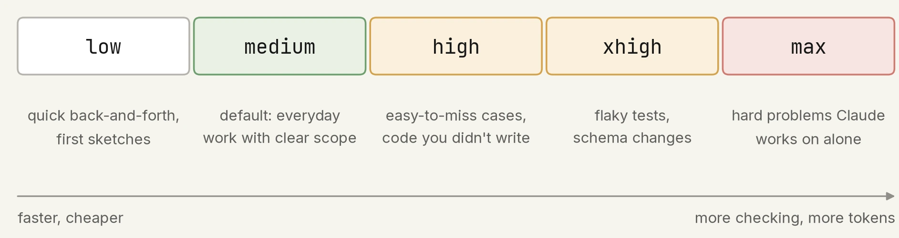{.diagram fig-alt="Five effort levels from faster and cheaper to more checking and more tokens. low: quick back-and-forth and first sketches. medium, the default: everyday work with clear scope. high: easy-to-miss cases and code you didn't write. xhigh: flaky tests and schema changes. max: hard problems Claude works on alone."}

:::: {.columns}

::: {.column width="50%"}
::: {.card-green .card-compact}
**Change it** · `/effort high` for the session; put `ultrathink` in one prompt for a single hard question.
:::
:::

::: {.column width="50%"}
::: {.card-amber .card-compact}
**Don't bother** · "think step by step" and "be thorough" are ordinary text; they can't lift Claude past its effort level.
:::
:::

::::

::: {.source}
Source: [Best practices: change the model and effort](https://code.claude.com/docs/en/best-practices#change-the-model-and-effort)
:::

::: {.notes}
Effort is the main control for how long Claude thinks. Medium is plenty for everyday work. Raise it when success depends on cases that are easy to miss, lower it when you are iterating quickly and reviewing each step anyway, and save max for hard problems Claude works on alone. Prompt phrases like "think harder" are ordinary text, not switches.
:::

## Subagents buy speed and fresh eyes, not intelligence {data-eyebrow="Part 4 · Defaults"}

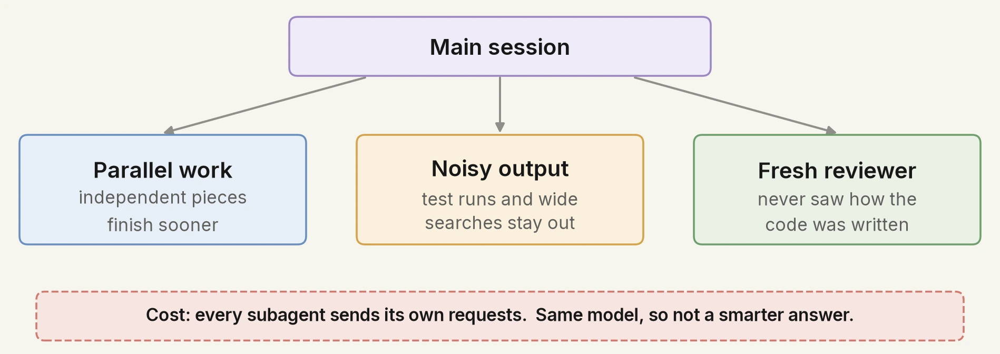{.diagram fig-alt="A main session fans out to three uses of subagents: parallel work, where independent pieces finish sooner; noisy output, where test runs and wide searches stay out of the main conversation; and a fresh reviewer that never saw how the code was written. A dashed note: every subagent sends its own requests, and delegating does not by itself give a better answer."}

::: {.card-green .card-compact}
**Spend less** · set `model: haiku` for simple jobs, ask for short summaries, and give a reviewer only `tools: Read, Grep, Glob` so it can't edit.
:::

::: {.source}
Source: [Best practices: know what subagents cost](https://code.claude.com/docs/en/best-practices#know-what-subagents-cost)
:::

::: {.notes}
Claude already delegates on its own. Subagents pay off for independent work in parallel, for keeping long output out of your conversation, and for getting a reviewer who did not see the code being written. They cost tokens, and sometimes time, because a fresh subagent must gather context again. Delegation does not guarantee a better answer; use it for parallel work, focused context, and independent review.
:::

## Pay only for the context you need {data-eyebrow="Part 4 · Defaults" .fill-tiles}

::: {.tiles .tiles-3}

::: {.tile}
::: {.tile-value}
/clear
:::
::: {.tile-text}
Between unrelated tasks. Each request re-sends the whole conversation, discounted only while cached. `/clear oauth-migration` names the session to resume later.
:::
:::

::: {.tile}
::: {.tile-value}
/compact &lt;focus&gt;
:::
::: {.tile-text}
Steer the summary: `/compact keep the API changes`. On a long session it is itself a big request.
:::
:::

::: {.tile}
::: {.tile-value}
/usage
:::
::: {.tile-text}
Breaks spend down by skill, subagent, plugin, and MCP server, and flags long context or cache misses.
:::
:::

:::

::: {.card-subtle .card-compact}
Running out of context is now rare: most models have a 1M-token window and compaction happens on its own. The reason to clear is focus and cost.
:::

::: {.source}
Sources: [Best practices: keep cost and context down](https://code.claude.com/docs/en/best-practices#keep-cost-and-context-down) · [Prompt caching](https://code.claude.com/docs/en/prompt-caching)
:::

::: {.notes}
With large context windows and automatic compaction, you will rarely run out of context. You can still pay for context you do not need, because each request sends the whole conversation. Prompt caching bills the repeated part at a reduced rate while the cache is warm, and at full price once it expires. Clear between unrelated tasks, give compaction a focus, and look at the usage breakdown before guessing where tokens went.
:::

# Steer the session {data-eyebrow="Part 5"}

No configuration replaces watching the first minute.

::: {.symptom}
Claude heads somewhere you didn't intend, and corrections stop helping.
:::

::: {.notes}
Configuration handles the predictable. For everything else, there are a few controls worth knowing by heart.
:::

## Three controls worth knowing by heart {data-eyebrow="Part 5 · Steer"}

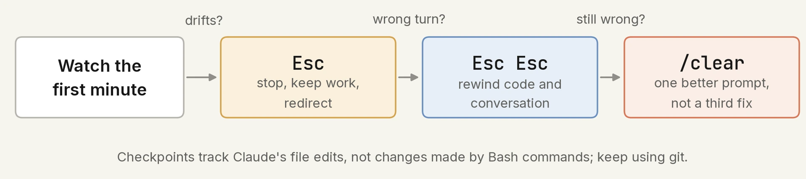{.diagram fig-alt="A sequence of escalating controls. Watch the first minute. If Claude drifts, press Esc to stop, keep the work, and redirect. If it took a wrong turn, press Esc twice to rewind code and conversation. If it is still wrong, run /clear and write one better prompt instead of a third fix. Note: checkpoints track Claude's file edits, not changes made by Bash commands; keep using git."}

::: {.card-amber .card-compact}
**Two corrections, then reset** · a third correction adds to a conversation that already contains two failed attempts. `/clear` plus one prompt that folds in what you learned works better almost every time.
:::

::: {.source}
Sources: [Best practices: steer the session](https://code.claude.com/docs/en/best-practices#steer-the-session) · [Checkpointing](https://code.claude.com/docs/en/checkpointing)
:::

::: {.notes}
Watch the first minute. Escape stops Claude mid-action and keeps everything so far. Pressing Escape twice opens the rewind menu, which can roll back the code, the conversation, or both, so it is cheap to try the bolder approach first. And after two failed corrections, clear the session and write one better prompt. Checkpoints do not cover files changed only by shell commands, so keep using git.
:::

# Let Claude run without you {data-eyebrow="Part 6"}

Everything so far matters more when nobody is watching.

::: {.symptom}
You want Claude to keep working when nobody is watching.
:::

::: {.notes}
The same ideas apply to unattended runs, with higher stakes: if Claude builds on a wrong assumption overnight, nobody corrects it.
:::

## Five questions before you walk away {data-eyebrow="Part 6 · Unattended" .fill-tiles}

::: {.tiles .tiles-5}

::: {.tile}
::: {.tile-num}
1
:::
::: {.tile-title}
Done looks like?
:::

::: {.tile-text}
A goal, a spec, or a failing test to turn green.
:::
:::

::: {.tile}
::: {.tile-num}
2
:::
::: {.tile-title}
Can it check?
:::

::: {.tile-text}
Tests, a `Stop` hook, a review step.
:::
:::

::: {.tile}
::: {.tile-num}
3
:::
::: {.tile-title}
Can touch what?
:::

::: {.tile-text}
Permission rules, `dontAsk`, the sandbox, one branch.
:::
:::

::: {.tile}
::: {.tile-num}
4
:::
::: {.tile-title}
What stops it?
:::

::: {.tile-text}
`--max-turns`, `--max-budget-usd`, a spend limit.
:::
:::

::: {.tile}
::: {.tile-num}
5
:::
::: {.tile-title}
Who signs off?
:::

::: {.tile-text}
A person approves the merge or deploy.
:::
:::

:::

::: {.source}
Source: [Best practices: let Claude run without you](https://code.claude.com/docs/en/best-practices#let-claude-run-without-you)
:::

::: {.notes}
Before leaving a task running, answer five questions. Does it know what done looks like? Can it check its own work? What is it allowed to touch? What stops it? And who approves the result?
:::

## The answers, as flags {data-eyebrow="Part 6 · Unattended"}

```{.bash filename="migrate.sh"}
for file in $(cat files.txt); do
  claude --bare -p "Migrate $file to the new logger API; commit if pnpm test passes. Reply OK or FAIL." \
    --allowedTools "Read,Edit,Bash(pnpm test *),Bash(git add *),Bash(git commit *)" \
    --permission-mode dontAsk \
    --max-turns 20
done
```

::: {.tiles}

::: {.tile}
::: {.tile-value}
\-\-allowedTools
:::
::: {.tile-text}
Pre-approves exactly the tools the task needs.
:::
:::

::: {.tile}
::: {.tile-value}
dontAsk
:::
::: {.tile-text}
Refuses anything that would otherwise prompt.
:::
:::

::: {.tile}
::: {.tile-value}
\-\-max-turns 20
:::
::: {.tile-text}
Stops a run that loses its way. Try three files first.
:::
:::

::: {.tile}
::: {.tile-value}
\-\-bare
:::
::: {.tile-text}
Skips hooks and `CLAUDE.md`, so the check lives in the prompt.
:::
:::

:::

::: {.source}
Sources: [Best practices: run Claude from a script](https://code.claude.com/docs/en/best-practices#run-claude-from-a-script) · [Bare mode](https://code.claude.com/docs/en/headless#start-faster-with-bare-mode)
:::

::: {.notes}
Here those answers become flags. Allowed tools pre-approves exactly what the task needs, don't-ask mode refuses anything else that would prompt, and the turn cap stops a run that loses its way. Claude replies OK or FAIL for each file. Try it on three files first, fix the prompt, then run the rest. Bare mode starts faster because it skips your hooks, skills, MCP servers, and every CLAUDE.md file, and it needs an API key or provider credentials. So the check has to live in the prompt and the allowed tools: here Claude may run the tests and commits only when they pass. If the run needs a hook, leave bare mode off.
:::

## Parallel sessions need separate checkouts {data-eyebrow="Part 6 · Unattended"}

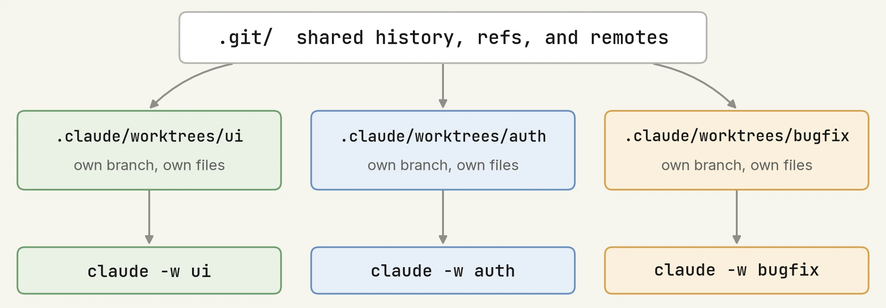{.diagram fig-alt="One shared .git directory with history, refs, and remotes feeds three worktrees under .claude/worktrees: ui, auth, and bugfix. Each has its own branch and files and is driven by its own claude -w session."}

:::: {.columns}

::: {.column width="50%"}
::: {.card-green .card-compact}
**Missing files** · a worktree is a fresh checkout. List small gitignored files such as `.env` in `.worktreeinclude`.
:::
:::

::: {.column width="50%"}
::: {.card-blue .card-compact}
**Free reviewer** · a second session reviewing the first's work hasn't seen how it was written.
:::
:::

::::

::: {.source}
Source: [Best practices: run sessions in parallel](https://code.claude.com/docs/en/best-practices#run-sessions-in-parallel)
:::

::: {.notes}
When separate pieces of work run at once, give each its own checkout so edits cannot collide. The worktree flag starts a session in a new worktree. Because it is a fresh checkout, ignored files such as environment files are missing; the worktree include file copies the small ones in. A second session is also the easiest independent reviewer you can get.
:::

## Advice you can stop following {data-eyebrow="Wrap-up"}

::: {.retired}

::: {.retired-head}
Old habit
:::

::: {.retired-head}
Why it's gone
:::

::: {.retired-old}
Manage the context window aggressively
:::

::: {}
1M-token windows and automatic compaction make running out rare. Clear for focus and cost.
:::

::: {.retired-old}
Add IMPORTANT or ALL CAPS
:::

::: {}
Plain lines are followed. A rule that can't bend needs a hook; a lost line needs a shorter file.
:::

::: {.retired-old}
Use subagents to protect context
:::

::: {}
Overflow is rare. Use them for parallel work, keeping noisy output out of context, and fresh review, and budget the tokens.
:::

::: {.retired-old}
Delegate for a better answer
:::

::: {}
Same model, same answer. A fresh reviewer helps; delegation alone doesn't.
:::

::: {.retired-old}
"think hard", "be thorough"
:::

::: {}
Set the effort level, or use `ultrathink` for one turn.
:::

:::

::: {.source}
Source: [Best practices: what you can stop doing](https://code.claude.com/docs/en/best-practices#what-you-can-stop-doing)
:::

::: {.notes}
Some popular advice is now out of date. It was good advice when models needed the workaround, but they have caught up. Context rarely runs out. Emphasis in capitals mostly makes Claude over-apply a rule. Subagents do not make answers smarter. And thinking phrases are not switches: effort is.
:::

## Summary {data-eyebrow="Wrap-up" .fill-tiles}

::: {.tiles .tiles-summary}

::: {.tile .tile-clay}
::: {.tile-heading}
Context
:::
::: {.tile-text}
Write down only what Claude can't find. Keep `CLAUDE.md` short; scope the rest.
:::
:::

::: {.tile .tile-green}
::: {.tile-heading}
Check
:::
::: {.tile-text}
Give it something that passes or fails, and ask for the evidence.
:::
:::

::: {.tile .tile-blue}
::: {.tile-heading}
Enforce
:::
::: {.tile-text}
Hooks and deny rules for the few rules that can't bend; guidance for the rest.
:::
:::

::: {.tile .tile-amber}
::: {.tile-heading}
Steer
:::
::: {.tile-text}
Watch the first minute. `Esc`, rewind, or `/clear` after two failed corrections.
:::
:::

:::

::: {.card-subtle .closing-line}
Delegate the work. Keep ownership of the result.
:::

::: {.source}
Source: [Best practices for Claude Code](https://code.claude.com/docs/en/best-practices)
:::

::: {.notes}
To sum up: tell Claude what it cannot see, give it a check to run and ask for evidence, enforce only the rules that cannot have exceptions, and steer the session when it drifts. Change the defaults only when they cost too much. Claude can do the work; you still own the result.
:::

## Resources {data-eyebrow="Wrap-up"}

::: {.link-list}

::: {.link-row}
[Best practices for Claude Code](https://code.claude.com/docs/en/best-practices)
[code.claude.com/docs/en/best-practices]{.link-url}
[The source for most of this talk. Read it first.]{.link-desc}
:::

::: {.link-row}
[How Claude Code works](https://code.claude.com/docs/en/how-claude-code-works)
[code.claude.com/docs/en/how-claude-code-works]{.link-url}
[The agentic loop, built-in tools, and sessions.]{.link-desc}
:::

::: {.link-row}
[Hooks guide](https://code.claude.com/docs/en/hooks-guide)
[code.claude.com/docs/en/hooks-guide]{.link-url}
[Turn checks and rules into configuration Claude Code enforces.]{.link-desc}
:::

::: {.link-row}
[Explore the context window](https://code.claude.com/docs/en/context-window)
[code.claude.com/docs/en/context-window]{.link-url}
[An interactive view of what loads into context, and when.]{.link-desc}
:::

:::

::: {.notes}
These links lead to the official documentation behind every slide. The best-practices page is the one to read first.
:::

## Thank you {data-eyebrow="Questions" .closing}

::: {.lead}
Other [slide decks](https://www.indrapatil.com/presentations/) on software engineering practices
:::

::: {.closing-icons}
<a class="deck-icon-link" href="https://www.linkedin.com/in/indrajeet-patil-ph-d-397865174/" aria-label="LinkedIn"><span class="deck-icon deck-icon-brands-linkedin" aria-hidden="true"></span></a>
&nbsp;&nbsp;&nbsp;
<a class="deck-icon-link" href="https://github.com/IndrajeetPatil" aria-label="GitHub"><span class="deck-icon deck-icon-brands-github" aria-hidden="true"></span></a>
&nbsp;&nbsp;&nbsp;
<a class="deck-icon-link" href="mailto:patilindrajeet.science@gmail.com" aria-label="Email"><span class="deck-icon deck-icon-solid-envelope" aria-hidden="true"></span></a>
:::

::: {.notes}
Thank you for listening. Questions and examples from your own workflows are welcome.
:::
