---
format:
  revealjs:
    css: style.css
    theme: black
    # Use CSS image sizing; RevealJS stretching can collapse lazy images in scroll view.
    auto-stretch: false
    width: 1280
    height: 720
    margin: 0.08
    transition: fade
    revealjs-plugins:
      - a11y
    revealjs-a11y:
      # 0.2.3's menus introduce ARIA failures; retain our slide-menu handling.
      slide-menu-a11y: false
      menu: false
      # Use the extension's core accessibility fixes without extra UI/shortcuts.
      font-size-controls: false
      font-selection: false
      text-spacing: false
      transcript: false
      slide-change-cue: false
    slide-number: true
    code-line-numbers: false
    preview-links: auto
    keyboard: true
    touch: true
    help: true
    include-in-header: meta-tags.html
    include-after-body: accessibility.html
    link-external-newwindow: true
    footer: ""
execute:
  echo: true
  eval: false
keywords: ["claude-code", "ai-agents", "cli", "anthropic", "software-engineering", "workflows", "skills", "multi-platform"]
description-meta: "A comprehensive guide to using Claude Code effectively as a CLI agent. Learn about tools, skills, workflows, context management, subagents, planning mode, and more."
license: "CC0 1.0 Universal"
pagetitle: "Effective Claude Code Usage"
author-meta: "Indrajeet Patil"
date-meta: "2026-10-07"
lang: "en"
dir: "ltr"
image: "media/social-media-card.webp"
image-alt: "Effective Claude Code Usage: From CLI to Cognitive Partner, with the orange Anthropic symbol in a terminal workshop."
canonical-url: "https://www.indrapatil.com/effective-claude-code-usage/"
jupyter: python3
---
## Effective Claude Code Usage {.deck-title}

::: {.title-copy}

::: {.title-subtitle}
From CLI to Cognitive Partner
:::

::: {.title-byline}
Indrajeet Patil &nbsp;·&nbsp; 2026
:::

::: {.title-source}
Source code on [GitHub](https://github.com/IndrajeetPatil/effective-claude-code-usage/)
:::

:::

::: {.title-art}
{fig-alt="The orange Anthropic symbol stands in a terminal workshop with a mounted tool assembling linked software modules. Cyan code panels and green test badges illustrate a coding partner that builds and verifies software."}
:::

::: {.notes}
Introduce the session and set the tone: Claude Code is not merely a conversational terminal assistant; it is a full CLI agent capable of reading, executing, reasoning, and verifying code.

The goal of this talk is to help developers move from naive prompt-response interactions to establishing a robust, collaborative engineering partnership with the tool.
:::
## What you'll learn {.smaller}

:::: {.columns}

::: {.column width="55%"}

::: {.tight-list style="font-size: 1.05em;"}
- **Agents vs chatbots** — what Claude Code actually is
- **Tools and permissions** — capabilities and safety boundaries
- **Skills & slash commands** — use them, then write your own
- **Context window** — what fills it and how to manage it
- **CLAUDE.md, memory, and hooks** — durable context and enforcement
- **Subagents and workflows** — parallel and orchestrated work
- **Planning mode** — explore before you edit
- **Prompting** — intent over instructions
- **Worktrees and `claude -p`** — parallel sessions and automation
:::

:::

::: {.column width="45%"}

::: {.card-green .card-compact style="font-size: 0.95em;"}
**Goal** · turn Claude Code from a smart autocomplete into a capable cognitive partner for complex engineering tasks.
:::

::: {.card-subtle .card-compact style="margin-top: 0.5em; font-size: 0.9em;"}
**Prerequisite** · Claude Code installed; you can run `claude` in a terminal.
:::

:::

::::

::: {.notes}
Walk through the talk roadmap. We will begin with fundamental concepts (what makes Claude Code an agent rather than a chatbot), transition through practical tooling (permissions, skills, and context management), explore architectural guardrails (CLAUDE.md, memory, hooks, and subagents), and finish with advanced workflows (planning mode, worktrees, and headless automation).

Emphasise that the prerequisite is simply having Claude Code installed and having basic familiarity with terminal workflows.
:::
# What Is Claude Code?

> *"It's not a chatbot in a terminal. It's an agent that reads, writes, searches, and executes — and loops until the task is done."*

::: {.notes}
This quote frames the mental model: chatbots give suggestions that you must manually copy, paste, run, and debug. An agent operates directly within your development environment, executing commands and iterating until acceptance criteria are satisfied.
:::
## Claude Code is a CLI Agent {.smaller}

:::: {.columns}

::: {.column width="50%"}

::: {.card-subtle .card-compact style="margin-bottom: 0.4em; font-size: 0.85em;"}
**CLI-first** · runs in your terminal, next to your shell, files, and Git history. Also available as desktop app, IDE extensions (VS Code, JetBrains), and web app.
:::

::: {.card-subtle .card-compact style="margin-bottom: 0.4em; font-size: 0.85em;"}
**Agentic** · not one-shot Q&A — loops: perceive → plan → act → observe → repeat
:::

::: {.card-subtle .card-compact style="margin-bottom: 0.4em; font-size: 0.85em;"}
**Tool-using** · reads files, writes code, runs bash, searches the web, spawns subagents, and can run workflows when enabled
:::

::: {.card-blue .card-compact style="font-size: 0.82em;"}
**Key insight** · the model decides *which* tools to use, *in what order*, and *how many times*.
:::

:::

::: {.column width="50%"}

::: {.terminal-box}
<pre><code>$ claude "add unit tests
  for src/auth.ts"

● Reading src/auth.ts
● Scanning test patterns
● Writing tests/auth.test.ts
● Running: npm test

✓ 12 tests passing
</code></pre>
:::

:::

::::

::: {.notes}
Explain what makes Claude Code unique as a CLI agent:
- CLI-first: It lives directly alongside your git repository, package manager, and shell tools.
- Autonomous loop: Instead of stopping after emitting text, it analyses command outputs, inspects compiler warnings, and refines its implementation.
- Dynamic tool selection: The model decides autonomously which tools to call, in what sequence, and when the task is complete.
:::
# Agents vs. Everything Else

> *"The difference between a chatbot and an agent is the difference between giving advice and doing the work."*

::: {.notes}
Transition into how agents fundamentally differ from autocomplete tools and web-based chat interfaces.
:::
## Intelligence Spectrum {.smaller}

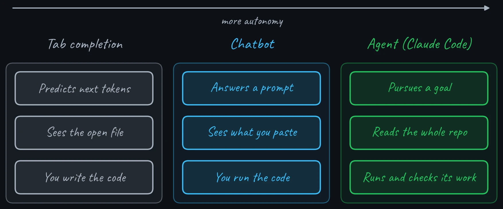{fig-align="center" fig-alt="Three columns ordered by increasing autonomy. Tab completion predicts next tokens, sees the open file, and you write the code. A chatbot answers a prompt, sees what you paste, and you run the code. An agent such as Claude Code pursues a goal, reads the whole repository, and runs and checks its own work."}

::: {.notes}
Walk through the three autonomy tiers:
1. Autocomplete (Tab completion): Predicts the next few tokens based on the current file; you do the thinking and structure the code.
2. Chatbots: Provide consultative advice based on pasted snippets; you remain responsible for running the code and testing it.
3. Agents: Given a goal, they autonomously explore the repository, formulate a plan, execute edits, run tests, and self-correct on failure.
:::
## ReAct Agent Loop {.smaller}

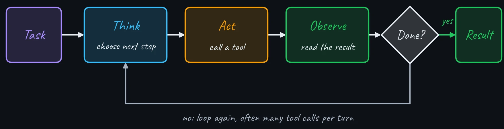{fig-align="center" fig-alt="ReAct agent loop: a task flows into think, act, and observe steps, then a done check. If not done, it loops back to think; if done, it returns a result."}

::: {.card-amber .card-compact style="font-size:0.82em; margin-top:0.6em;"}
**Why it matters** · the loop only ends well if Claude can tell when it is done. Give it a check to run — tests, a build, a screenshot — and it will iterate against that signal instead of stopping at "looks right".
:::

::: {.notes}
Explain the ReAct (Reason + Act) loop:
The model reasons ('think'), performs an action via a tool ('act'), and inspects the output ('observe').

Crucial takeaway: The agent cannot reliably know when it is done unless you supply an objective verification signal—such as automated tests, a build command, or linter output.
:::
# Tools & Capabilities

> *"A tool is a function the model can call. The model decides when — and how many times."*

::: {.notes}
Introduce the tools and capabilities available to Claude Code during execution.
:::
## Tool Categories {.smaller}

| Category | Tools | Enables |
|----------|-------|---------|
| **File I/O** | `Read` · `Write` · `Edit` | Read any file; create or surgically modify code |
| **Search** | `Glob` · `Grep` | Find files by name; search content by regex |
| **Shell** | `Bash` | Run tests, git, npm, docker — any terminal command |
| **Web** | `WebFetch` · `WebSearch` | Fetch docs, read changelogs, search answers |
| **Agents** | `Agent` · `Workflow` | Spawn subagents, isolate context, orchestrate workflows |
| **[MCP](https://code.claude.com/docs/en/mcp)** | Server-defined | GitHub PRs, Jira tickets, Postgres, and more |

::: {.card-blue .card-compact style="font-size:0.78em;"}
**Permissions + sandboxing** · prompts depend on the active permission mode and rules. Sandboxed Bash can run automatically inside OS-enforced boundaries; explicit deny rules still apply. Configure both with [`/permissions`](https://code.claude.com/docs/en/permissions) and [`/sandbox`](https://code.claude.com/docs/en/sandboxing).
:::

::: {.notes}
Detail the tool categories:
- File I/O: Reading and surgical edits (`Read`, `Edit`, `Write`).
- Search: Finding files and symbols (`Glob`, `Grep`).
- Shell: Executing arbitrary bash commands in the workspace.
- Web: Fetching remote documentation or inspecting API changes (`WebFetch`, `WebSearch`).
- Orchestration: Spawning subagents or workflows.
- MCP: Connecting external services like databases, GitHub, or issue trackers.

Highlight the role of sandboxing and permission rules in bounding shell execution.
:::
## Choose a Permission Mode {.smaller}

| Mode | Runs without asking | Best fit |
|------|----------------------|----------|
| **Manual** | Reads only | Getting started; sensitive work |
| **Accept edits** | Reads, file edits, common filesystem commands | Iterating on code you will review |
| **Plan** | Reads only | Explore before implementation |
| **Auto** | Classifier-approved actions (still blocks risky ones) | Default in recent versions; long tasks |
| **Don't ask** | Only pre-approved tools | Locked-down CI and scripts |
| **Bypass** | Everything | Isolated containers or VMs only |

::: {.card-amber .card-compact style="font-size:0.78em; margin-top:0.4em;"}
**Switch with `Shift+Tab`** · it cycles manual → accept edits → plan → auto mid-session. Permission rules decide what Claude may attempt; the sandbox enforces filesystem and network boundaries for Bash. In auto mode a classifier reviews actions in your place — it cuts prompts but does not replace your review of sensitive work.
:::

::: {style="font-size:0.55em; text-align:center; margin-top:0.35em;"}
Sources: [Permission modes](https://code.claude.com/docs/en/permission-modes) · [Sandboxing](https://code.claude.com/docs/en/sandboxing)
:::

::: {.notes}
Discuss the permission modes and when to choose each:
- Manual & Plan: Best when exploring or doing high-stakes architectural reviews.
- Accept edits: Practical balance for rapid local iteration on code you will review before committing.
- Auto: Uses a classifier to approve low-risk actions automatically while prompting on sensitive operations.
- Don't ask & Bypass: Strictly for automated pipelines and isolated container environments.

Mention `Shift+Tab` as the quick keyboard shortcut to toggle modes mid-flight.
:::
# Skills & Slash Commands

> *"The `/` menu is a launcher. The action type tells you how Claude will execute it."*

::: {.notes}
Introduce skills and slash commands as repeatable ways to drive agent behavior.
:::
## [`/` Actions](https://code.claude.com/docs/en/commands) — Know What You Are Running {.smaller}

:::: {.columns}

::: {.column width="50%"}

::: {style="font-size: 0.88em;"}
The `/` menu combines built-in commands, bundled skills, workflows, plugin actions, and MCP prompts. Skills are reusable instructions that load on demand; many can activate from their description, but `/verify` and `/code-review` run only when you invoke them.
:::

| Action | Kind · purpose |
|--------|----------------|
| `/code-review` | Skill · correctness review |
| `/simplify` | Skill · apply cleanup fixes |
| `/verify` | Skill · run and observe the change |
| `/run` | Skill · launch and drive the app |

:::

::: {.column width="50%"}

| Action | Kind · purpose |
|--------|----------------|
| `/deep-research` | Workflow · cited research |
| `/security-review` | Built-in · audit branch diff |
| `/init` | Built-in · generate CLAUDE.md |
| `/review` | Built-in · fast, read-only PR review |

::: {.card-green .card-compact style="font-size:0.78em; margin-top:0.8em;"}
**Install-dependent** · availability varies by version, plan, platform, plugins, and MCP servers. Use `/help` for commands and `/skills` for loaded skills.
:::

:::

::::

::: {.notes}
Clarify the `/` action taxonomy:
The slash menu includes built-in commands (like `/init` and `/review`), bundled skills (like `/code-review` and `/verify`), and workflows.

Skills load dynamically on demand based on their description, keeping baseline context lean.
:::
## Write Your Own [Skill](https://code.claude.com/docs/en/skills) {.smaller}

:::: {.columns}

::: {.column width="55%"}

::: {.terminal-box}
<pre><code># .claude/skills/release-notes/SKILL.md
---
description: Draft release notes from merged
  PRs. Use when preparing a release.
disable-model-invocation: true
allowed-tools: Bash(gh pr list *) Read
---

1. List PRs merged since the last tag.
2. Group them: features, fixes, chores.
3. Write CHANGELOG.md in house style.
</code></pre>
:::

:::

::: {.column width="45%"}

::: {.card-green .card-compact style="font-size:0.85em;"}
**When to write one** · you have pasted the same multi-step instructions into a prompt more than twice.
:::

::: {.card-subtle .card-compact style="font-size:0.82em; margin-top:0.4em;"}
**Where** · `.claude/skills/<name>/` for the team (commit it), `~/.claude/skills/<name>/` for you. The folder name becomes `/name`.
:::

::: {.card-blue .card-compact style="font-size:0.82em; margin-top:0.4em;"}
**Who invokes it** · Claude loads a skill when its `description` matches the task. Set `disable-model-invocation: true` for actions with side effects, so they run only when you type `/name`.
:::

::: {.card-amber .card-compact style="font-size:0.78em; margin-top:0.4em;"}
**Cheap until used** · only descriptions sit in context; the body loads on invocation. Existing `.claude/commands/*.md` files keep working as skills.
:::

:::

::::

::: {style="font-size:0.55em; text-align:center; margin-top:0.4em;"}
Source: [Extend Claude with skills](https://code.claude.com/docs/en/skills)
:::

::: {.notes}
Explain when and how to author custom skills:
- Trigger: If you find yourself repeatedly typing similar multi-step instructions, turn them into a skill.
- Structure: A markdown file in `.claude/skills/<name>/SKILL.md` with YAML frontmatter.
- Safety: For actions with side effects (like drafting PRs or running migrations), set `disable-model-invocation: true` so the skill runs only upon explicit user invocation.
:::
## [Slash Commands](https://code.claude.com/docs/en/commands) — Session Control {.smaller}

:::: {.columns}

::: {.column width="50%"}

**Session & Context**

| Command | Purpose |
|---------|---------|
| `/clear` | Reset conversation history |
| `/compact` | Compress history, keep summary |
| `/context` | Inspect context usage and heavy inputs |
| `/rewind` | Restore or summarize from a checkpoint |
| `/goal` | Keep working until a condition holds |
| `/usage` | Show usage and limit breakdown |

:::

::: {.column width="50%"}

**Modes & Control**

| Command | Purpose |
|---------|---------|
| `/plan` | Enter planning mode |
| `/permissions` | Manage allow, ask, and deny rules |
| `/sandbox` | Configure OS-enforced Bash isolation |
| `/model` | Switch Claude model |
| `/help` | List all commands |
| `/workflows` | Watch live workflow progress |

::: {.card-amber .card-compact style="font-size:0.78em; margin-top:0.5em;"}
**Commands move fast** · use `/help` as the source of truth for your install. `/cost` and `/stats` are current aliases for `/usage`.
:::

:::

::::

::: {.notes}
Review key slash commands for session control:
- Context management: `/clear` (resets history), `/compact` (compresses history into a focused summary), and `/context` (displays token usage breakdown).
- Control & Modes: `/plan` (enters read-only planning), `/permissions` and `/sandbox` (configure safety boundaries), and `/goal` (maintains execution towards a stopping condition).
:::
# Context Window

> *"The context window is finite. What's in it decides what Claude can reason about."*

::: {.notes}
Introduce the context window as the most critical and scarce resource during agent interactions.
:::
## What Fills the Context? {.smaller}

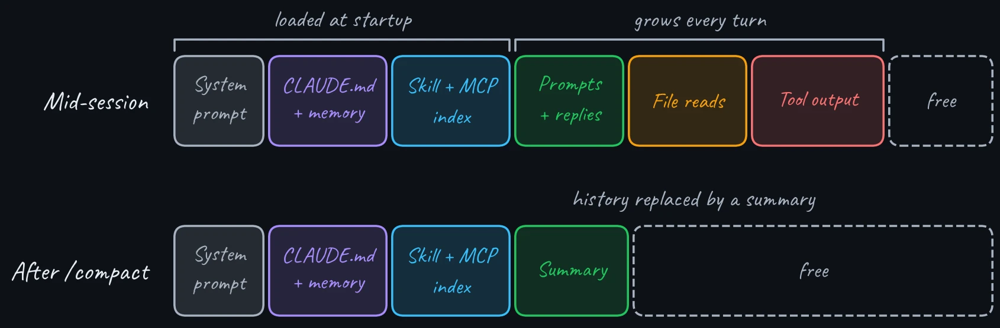{fig-align="center" fig-alt="Two context-window bars. Mid-session: system prompt, CLAUDE.md plus memory, and the skill and MCP index are loaded at startup; prompts and replies, file reads, and tool output grow every turn, leaving little free space. After /compact: the startup items remain, history is replaced by a short summary, and most of the window is free."}

:::: {.columns}

::: {.column width="50%"}
::: {.card-amber .card-compact style="font-size:0.8em;"}
**Fills fast** · full-file reads and verbose logs dominate. As the window fills, earlier instructions get less attention.
:::
:::

::: {.column width="50%"}
::: {.card-green .card-compact style="font-size:0.8em;"}
**Fix** · `/clear` between unrelated tasks; `/compact focus on X` to steer the summary; send broad searches to a subagent so only its findings come back.
:::
:::

::::

::: {style="font-size:0.55em; text-align:center; margin-top:0.4em;"}
Sources: [Explore the context window](https://code.claude.com/docs/en/context-window) · [How Claude Code works](https://code.claude.com/docs/en/how-claude-code-works#the-context-window)
:::

::: {.notes}
Break down what fills the context window:
Startup instructions (system prompt, CLAUDE.md, auto memory, tool schemas) take up fixed baseline tokens, while turn-by-turn conversation, full-file reads, and verbose terminal outputs consume the rest.

Mitigations: Run `/clear` between unrelated tasks, use targeted `/compact` summaries, and delegate large exploration tasks to subagents so only their synthesis enters the primary context.
:::
# CLAUDE.md, Memory & Hooks

> *"CLAUDE.md is durable instruction context; auto memory is Claude's local notebook; hooks are the rules that always run."*

::: {.notes}
Introduce durable project memory and deterministic validation mechanisms.
:::
## How [CLAUDE.md](https://code.claude.com/docs/en/memory) Is Loaded {.smaller}

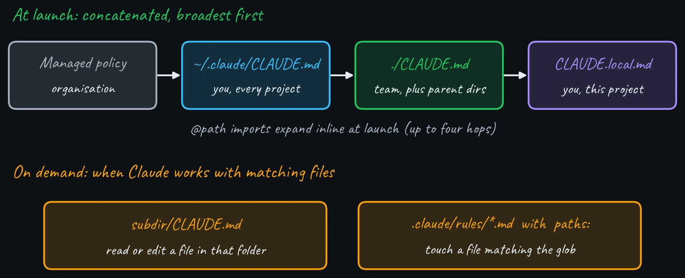{fig-align="center" fig-alt="At launch, Claude Code concatenates instruction files from broadest to most specific: managed policy, ~/.claude/CLAUDE.md, ./CLAUDE.md with parent directories, then CLAUDE.local.md; @path imports expand inline up to four hops. On demand, subdirectory CLAUDE.md files load when Claude reads or edits files in that folder, and .claude/rules files with paths globs load when Claude touches matching files."}

::: {.card-blue .card-compact style="font-size:0.8em; margin-top:0.6em;"}
**Scale without bloat** · imports organise a long file but still load at launch. Move guidance that only matters for part of the repo into subdirectory files or path-scoped rules.
:::

::: {style="font-size:0.55em; text-align:center; margin-top:0.4em;"}
Source: [How Claude remembers your project](https://code.claude.com/docs/en/memory)
:::

::: {.notes}
Explain the hierarchical loading order of `CLAUDE.md`:
Global user config (`~/.claude/CLAUDE.md`) is loaded first, followed by the repository root `CLAUDE.md` and local developer overrides (`CLAUDE.local.md`).

To avoid bloat, use subdirectory `CLAUDE.md` files or path-scoped rules (`.claude/rules/*.md`) that activate only when touching files in those specific directories.
:::
## CLAUDE.md Anatomy {.smaller}

:::: {.columns}

::: {.column width="60%"}

::: {.terminal-box}
<pre><code># My Project CLAUDE.md

## Stack
TypeScript monorepo, Node 22, pnpm

## Conventions
- ESM only (no require())
- Tests: Vitest + @testing-library
- Branch: feat/&lt;ticket&gt;-description

## Commands
- Test:  pnpm test
- Build: pnpm build

## Never
- Push directly to main
- Commit .env files
</code></pre>
:::

:::

::: {.column width="40%"}

::: {.card-green style="font-size:0.85em;"}
**Auto-generate**

Run `/init` in any repo — Claude inspects the codebase and writes a CLAUDE.md for you. Edit it to add conventions and "never do" rules.
:::

::: {.card-subtle style="font-size:0.82em; margin-top:0.6em;"}
**Keep it lean** · aim for under 200 lines. Include only commands, conventions, decisions, and gotchas Claude cannot infer from the repo.
:::

::: {.card-blue style="font-size:0.82em; margin-top:0.6em;"}
**Test each line** · would removing it cause a mistake? If not, cut it. When two rules contradict, Claude may follow either.
:::

:::

::::

::: {.notes}
Break down an ideal `CLAUDE.md`:
Keep it concise (aim for under 200 lines). Document the tech stack, test/build commands, non-obvious conventions, and hard prohibitions ('Never push to main').

Encourage running `/init` to generate an initial baseline, then pruning anything the agent can easily deduce on its own.
:::
## Memory Is Context, Not Enforcement {.smaller}

{.concept-illustration fig-align="center" fig-alt="Dotted arrows from project instructions and remembered notes guide the orange Anthropic symbol towards a solid enforcement checkpoint. Guidance informs a decision, while a gate can require a check or block an action."}

:::: {.columns}

::: {.column width="50%"}

::: {.card-green .card-compact style="font-size:0.82em;"}
**Keep context lean** · put non-obvious commands, conventions, decisions, and gotchas in CLAUDE.md. Claude's auto memory is local and per-repository; its index loads only the first 200 lines or 25 KB, with topic files loaded on demand.
:::

:::

::: {.column width="50%"}

::: {.card-amber .card-compact style="font-size:0.78em; margin-top:0.4em;"}
**Review and enforce** · use `/context` to inspect loaded files and `/memory` to review notes; prune stale or conflicting facts. Use permission deny rules or hooks when an action must be blocked or a check must always run.
:::

:::

::::

::: {style="font-size:0.55em; text-align:center; margin-top:0.4em;"}
Source: [Claude Code memory documentation](https://code.claude.com/docs/en/memory)
:::

::: {.notes}
Reinforce a vital distinction: Memory and instructions are context, not hard enforcement.
Claude will generally follow guidelines, but probabilistic models can still overlook instructions when context is cluttered.

When a rule must never be violated, enforce it deterministically using permission deny rules or hooks rather than relying solely on prompt instructions.
:::
## [Hooks](https://code.claude.com/docs/en/hooks) — Automated Validation {.smaller}

:::: {.columns}

::: {.column width="52%"}

::: {.terminal-box}
<pre><code># .claude/settings.json
{
  "hooks": {
    "PostToolUse": [{
      "matcher": "Edit",
      "hooks": [{
        "type": "command",
        "command": "pnpm lint"
      }]
    }]
  }
}
</code></pre>
:::

:::

::: {.column width="48%"}

::: {.card-green .card-compact style="font-size:0.82em;"}
**What hooks do** · run shell commands automatically at lifecycle events — no per-prompt reminder needed.
:::

::: {.card-subtle .card-compact style="font-size:0.78em; margin-top: 0.4em;"}
**Key events** · `PreToolUse` · `PostToolUse` · `Stop` · `UserPromptSubmit` — and more
:::

::: {.card-blue .card-compact style="font-size:0.78em; margin-top: 0.4em;"}
**Use cases** · lint after edits · run typecheck before stopping · block risky bash commands · log file writes
:::

::: {.card-amber .card-compact style="font-size:0.78em; margin-top: 0.4em;"}
**Keep them scoped** · prefer narrow matchers and non-mutating checks unless automatic edits are truly intentional.
:::

:::

::::

::: {.notes}
Explain how hooks provide automated validation:
Hooks execute shell commands at deterministic lifecycle events (e.g., `PostToolUse` on `Edit` to automatically format or lint modified files).

This guarantees quality gates without requiring human reminders on every prompt.
:::
# Subagents & Workflows

> *"Subagents handle parallel work. Workflows are for the cases where simple fan-out is not enough."*

::: {.notes}
Transition into parallel execution primitives and complex orchestration.
:::
## [Subagent](https://code.claude.com/docs/en/sub-agents) Orchestration {.smaller}

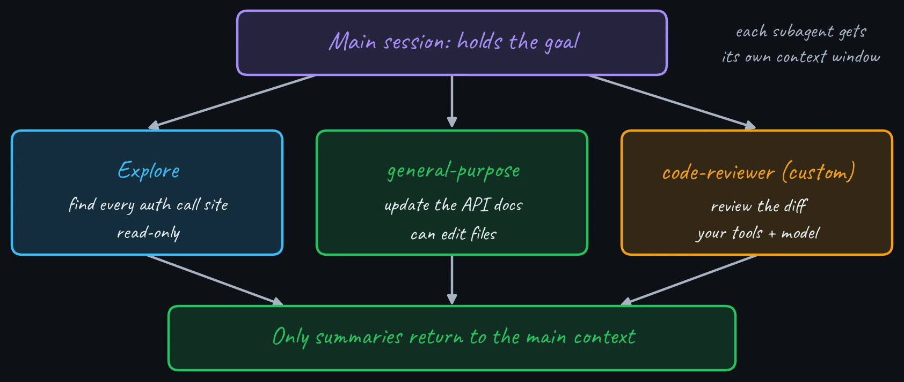{fig-align="center" fig-alt="The main session, which holds the goal, delegates to three subagents that each get their own context window: Explore finds every auth call site and is read-only; general-purpose updates the API docs and can edit files; a custom code-reviewer reviews the diff with your chosen tools and model. Only their summaries return to the main context."}

::: {.card-amber .card-compact style="font-size:0.8em; margin-top:0.6em;"}
**Custom subagents** · a Markdown file in `.claude/agents/` with `name`, `description`, and optional `tools` and `model`. Claude delegates when the description matches; `/agents` manages them.
:::

::: {.notes}
Explain subagent orchestration:
The primary session delegates bounded subtasks (e.g., searching for call sites, generating tests, reviewing diffs) to separate subagents.

Each subagent operates within its own independent context window, reporting back only its final findings, preserving the main session's token budget.
:::
## Choose the Right Parallel Primitive {.smaller}

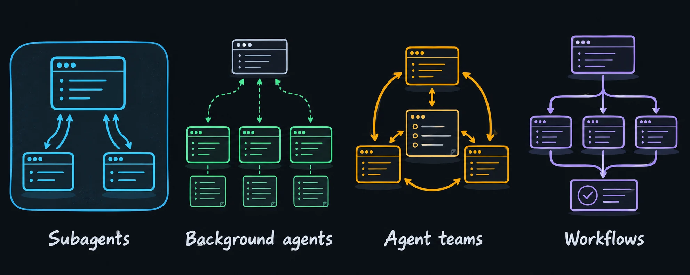{.concept-illustration .concept-illustration-dense fig-align="center" fig-alt="Four coordination patterns: subagents report back to one main session; background agents run as independent sessions; agent teams connect peers around a shared task board; workflows follow a scripted branching and joining path."}

:::: {.columns}

::: {.column width="50%"}

::: {.card-green .card-compact style="font-size:0.75em;"}
**Keep context focused** · use subagents when exploration or logs would clutter the main session; bring back a summary.
:::

::: {.card-blue .card-compact style="font-size:0.75em; margin-top:0.4em;"}
**Hand off and revisit** · dispatch and monitor background sessions with `claude agents`. **Research preview.**
:::

:::

::: {.column width="50%"}

::: {.card-amber .card-compact style="font-size:0.75em;"}
**Coordinate directly** · use teams only when workers must communicate. **Experimental and disabled by default.**
:::

::: {.card-subtle .card-compact style="font-size:0.75em; margin-top:0.4em;"}
**Repeat control flow** · use workflows for many agents, cross-checks, or resumability, once a few subagents are insufficient.
:::

:::

::::

::: {.card-blue .card-compact style="font-size:0.78em; margin-top: 0.4em;"}
**Default** · start with one agent; request extra coordination only when it materially helps.
:::

::: {style="font-size:0.55em; text-align:center; margin-top:0.4em;"}
Source: [Run agents in parallel](https://code.claude.com/docs/en/agents)
:::

::: {.notes}
Compare parallel primitives:
- Subagents: Quick fan-out tasks reporting back to the parent session.
- Background agents: Independent detached sessions for long-running work.
- Agent teams: Peer workers collaborating on a shared task board.
- Workflows: Scripted, deterministic state machines.

Rule of thumb: Default to a single agent; add concurrency only when task independence justifies it.
:::
## Workflows — Advanced Orchestration {.smaller}

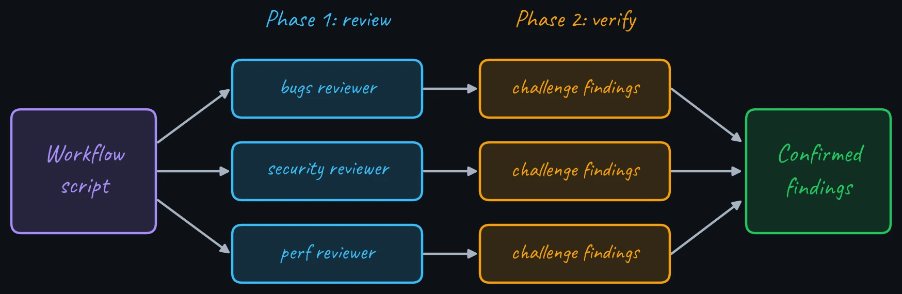{fig-align="center" fig-alt="Example workflow: a script runs phase 1, where bugs, security, and performance reviewers work in parallel, then phase 2, where each reviewer's findings are independently challenged, and only confirmed findings come out."}

::: {.card-green .card-compact style="font-size:0.8em; margin-top:0.6em;"}
**Orchestration as code** · the control flow above lives in a readable JavaScript script that runs in the background. `/workflows` shows live progress; save a run that worked so the team can reuse it.
:::

::: {.notes}
Introduce workflows:
Workflows model complex multi-stage engineering procedures as code (JavaScript/TypeScript scripts), defining explicit phases, validation gates, and budget limits.

They allow structured multi-agent collaboration with repeatable deterministic control flow.
:::
## Workflow Patterns — Use Sparingly {.smaller}

| Pattern | Use when | Simpler alternative |
|---------|----------|--------------------|
| **Adversarial verify** | A high-risk review needs independent challenge | One subagent + manual review |
| **Judge panel** | Several viable designs need comparison | Ask for tradeoffs first |
| **Loop-until-dry** | You need repeated search until no new findings | One targeted verification pass |
| **Pipeline** | Many items need the same multi-stage treatment | Script + one Claude pass |

::: {.card-blue .card-compact style="font-size:0.78em; margin-top:0.4em;"}
**Rule of thumb** · use a few subagents for turn-by-turn delegation; use a workflow when the plan itself needs repeatable loops, branching, cross-checking, or dozens of workers.
:::

::: {style="font-size:0.55em; text-align:center; margin-top:0.4em;"}
Source: [Dynamic workflows](https://code.claude.com/docs/en/workflows)
:::

::: {.notes}
Review common workflow patterns:
- Adversarial verify: Challenging findings independently before acceptance.
- Judge panel: Comparing competing implementation proposals.
- Loop-until-dry: Iteratively fixing issues until zero findings remain.
- Pipeline: Processing batches through uniform stages.

Always prefer simpler alternatives (a single prompt or subagent) unless complex multi-stage coordination is genuinely necessary.
:::
# Planning Mode

> *"Explore first. Edit second."*

::: {.notes}
Transition into planning mode as a safeguard for complex tasks.
:::
## [Planning Mode](https://code.claude.com/docs/en/permission-modes) Workflow {.smaller}

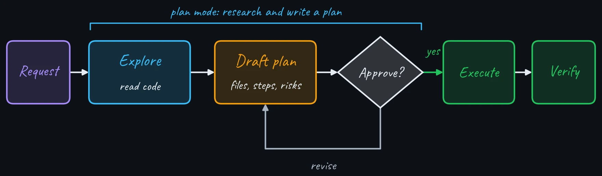{fig-align="center" fig-alt="Planning workflow: request, explore the code, draft a plan covering files, steps, and risks, then an approval decision. Explore and draft happen in plan mode where nothing is edited. If revised, the loop returns to the draft; if approved, Claude executes and then verifies."}

::: {.card-green .card-compact style="font-size:0.82em; margin-top:0.6em;"}
**Enter plan mode** · `/plan`, `Shift+Tab` until the status bar shows plan mode, or `claude --permission-mode plan`. Edit the plan directly or reply with feedback before approving.
:::

::: {.notes}
Describe the planning mode lifecycle:
The agent enters a read-only exploration state where it inspects files, maps dependencies, and drafts a comprehensive execution plan.

The user reviews, edits, or approves the plan before any modifications are written to disk.
:::
## When Planning Mode Pays Off {.smaller}

| Situation | Without Planning | With Planning |
|-----------|-----------------|---------------|
| Refactor across 20 files | Broken imports, partial changes | Coherent strategy, clean execution |
| Add auth to existing app | Picks wrong pattern for codebase | Existing patterns understood first |
| Multi-service change | Inconsistent API contracts | All surfaces identified upfront |
| Mysterious bug | Treats symptoms, not cause | Root-cause analysis before editing |

::: {.card-amber .card-compact style="font-size:0.78em;"}
**Rule of thumb** · plan when the approach is uncertain, the change spans multiple files, or the code is unfamiliar. If you can describe the diff in one sentence, direct execution is usually enough.
:::

::: {.card-blue .card-compact style="font-size:0.78em;"}
**Pro tip** · front-load clarity: state intent, constraints, and acceptance criteria upfront. Let Claude draft the plan. Approve it or give one round of feedback — then execute.
:::

::: {.notes}
Identify when planning mode delivers the highest return on investment:
- Multi-file refactorings.
- Implementing architectural changes or authentication flows.
- Modifying cross-service API contracts.
- Investigating complex, multi-root bugs.

If a task can be described in a single sentence with a predictable diff, direct execution is usually faster.
:::
## Keep the Blast Radius Small {.smaller}

:::: {.columns}

::: {.column width="50%"}

::: {.card-green .card-compact}
[**Before broad edits**]{style="font-size:0.95em;"}

- Use `/plan` for cross-file changes
- Start a worktree for parallel sessions
- State files, commands, and acceptance criteria
- Ask for a diff summary before commit
:::

:::

::: {.column width="50%"}

::: {.card-amber .card-compact}
[**Before accepting work**]{style="font-size:0.95em;"}

- Inspect `git diff`
- Run tests and lint
- Check generated artefacts
- Review the PR like any teammate's work
:::

:::

::::

::: {.card-blue .card-compact style="font-size:0.78em; margin-top:0.4em;"}
**Principle** · let Claude move quickly inside boundaries you can verify.
:::

::: {.notes}
Synthesise blast-radius containment:
Before broad edits: Plan ahead, isolate work in a dedicated worktree, and establish explicit acceptance criteria.
Before accepting changes: Inspect `git diff`, run tests and linters, and review the code as rigorously as human contributions.
:::
# Delegate Intent, Verify Work

> *"Claude Code is an execution engine. Give it intent, constraints, and a finish line; then verify what changed."*

::: {.notes}
Shift focus to effective prompting and outcome-driven delegation.
:::
## Define the What, Not the How {.smaller}

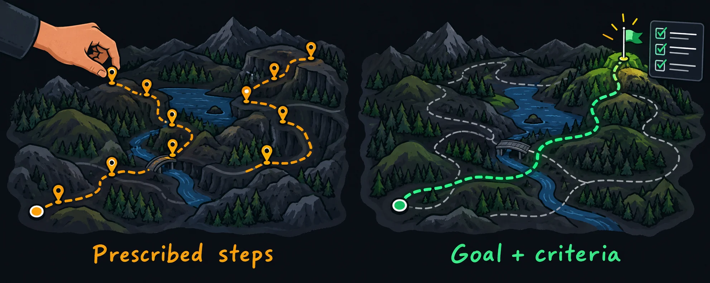{.concept-illustration fig-align="center" fig-alt="Two route maps contrast a route constrained by prescribed waypoints with several possible routes to a clear destination. The destination has a checklist, showing that the agent can choose its approach while success remains verifiable."}

::: {.card-green .card-compact style="font-size:0.85em;"}
**A concrete prompt** · "Add unit tests for the auth module. Done when: all public functions covered, edge cases tested, conventions followed, `pnpm test` passes."
:::

::: {.card-blue .card-compact style="font-size:0.78em; margin-top:0.4em;"}
**Before accepting** · run the named checks and inspect the tests. Passing a command alone does not prove the requested coverage or edge cases are present.
:::

::: {style="font-size:0.55em; text-align:center; margin-top:0.4em;"}
Source: [Claude Code best practices](https://code.claude.com/docs/en/best-practices)
:::

::: {.notes}
Advocate for outcome-driven prompting:
Specify the desired end state, constraints, and verification criteria ('what'), rather than prescribing brittle step-by-step commands ('how').

Allow the agent the flexibility to determine the optimal route, while holding it accountable to verifiable acceptance tests.
:::
# Git Worktrees

> *"When two Claude sessions edit the same files, you don't get double the speed — you get merge conflicts. Worktrees give each session its own universe."*

::: {.notes}
Introduce Git worktrees as the foundational primitive for concurrent agent development.
:::
## Why Parallel Sessions Need Isolation {.smaller}

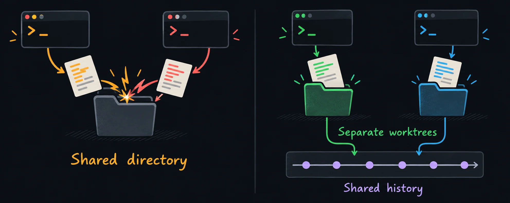{.concept-illustration fig-align="center" fig-alt="Two sessions collide while editing one shared folder. In separate worktrees, each session edits its own folder, while both remain connected to shared repository history."}

:::: {.columns}

::: {.column width="50%"}

::: {.card-amber .card-compact style="font-size:0.82em;"}
**The failure mode** · one session's half-finished edits can break another's tests. Switching tasks may require stash/pop gymnastics.
:::

:::

::: {.column width="50%"}

::: {.card-green .card-compact style="font-size:0.82em;"}
**The hand-off** · give each session its own branch; build and test in that checkout. Review and merge completed work on your schedule.
:::

:::

::::

::: {style="font-size:0.55em; text-align:center; margin-top:0.4em;"}
Source: [Parallel sessions with worktrees](https://code.claude.com/docs/en/worktrees)
:::

::: {.notes}
Explain the failure modes of running parallel sessions in the same directory:
Simultaneous edits cause conflicting changes, dirty working trees, and broken intermediate test runs.

Worktrees grant each session its own clean directory checkout while sharing repository history.
:::
## [Worktrees](https://code.claude.com/docs/en/worktrees) — How They Work {.smaller}

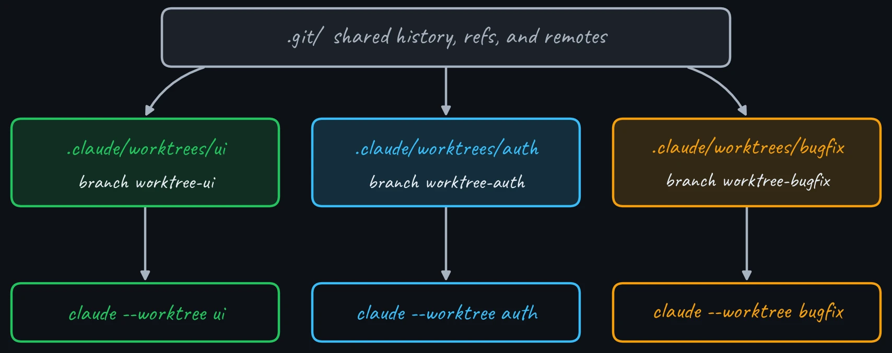{fig-align="center" fig-alt="One shared .git directory with history, refs, and remotes feeds three worktree directories under .claude/worktrees (ui, auth, and bugfix), each on its own worktree branch and each driven by its own claude --worktree session."}

:::: {.columns}

::: {.column width="50%"}
::: {.card-green .card-compact style="font-size:0.78em;"}
**Usage** · `claude --worktree feature-auth` creates an isolated worktree and starts Claude in it. `-w` is the short alias.
:::
:::

::: {.column width="50%"}
::: {.card-blue .card-compact style="font-size:0.78em;"}
**Pro tip** · add `.claude/worktrees/` to `.gitignore`. Use `.worktreeinclude` to copy selected gitignored setup files such as `.env` into new worktrees.
:::
:::

::::

::: {.notes}
Explain how to use worktrees with Claude Code:
Use `claude --worktree <name>` (or `-w <name>`) to create an isolated worktree and launch Claude directly inside it.

Configure `.worktreeinclude` to automatically replicate uncommitted environment configurations like `.env` files across worktrees.
:::
# Automation

> *"The same agent loop runs without a terminal session: in scripts, pipelines, and CI."*

::: {.notes}
Transition into headless execution and pipeline automation.
:::
## [Run Claude Non-Interactively](https://code.claude.com/docs/en/headless) {.smaller}

:::: {.columns}

::: {.column width="55%"}

::: {.terminal-box}
<pre><code># Pipe input in, get an answer out
$ cat build.log | claude -p \
    "explain the root cause"

# Pre-approve only the tools it needs
$ claude -p "fix the failing tests" \
    --allowedTools "Bash,Read,Edit"

# Structured output for scripts
$ claude -p "summarise this PR" \
    --output-format json | jq -r .result
</code></pre>
:::

:::

::: {.column width="45%"}

::: {.card-green .card-compact style="font-size:0.82em;"}
**`-p` / `--print`** · runs one task and exits; a non-zero exit code means the run failed, so scripts can branch on it.
:::

::: {.card-blue .card-compact style="font-size:0.82em; margin-top:0.4em;"}
**Reproducible in CI** · add `--bare` to skip local hooks, plugins, MCP servers, auto memory, and CLAUDE.md; pass what you need explicitly.
:::

::: {.card-amber .card-compact style="font-size:0.82em; margin-top:0.4em;"}
**Locked down** · `--permission-mode dontAsk` denies anything not pre-approved. Keep bypass mode for disposable containers.
:::

::: {.card-subtle .card-compact style="font-size:0.78em; margin-top:0.4em;"}
**In GitHub** · [Claude Code GitHub Actions](https://code.claude.com/docs/en/github-actions) responds to `@claude` mentions in issues and PRs.
:::

:::

::::

::: {style="font-size:0.55em; text-align:center; margin-top:0.4em;"}
Source: [Run Claude Code programmatically](https://code.claude.com/docs/en/headless)
:::

::: {.notes}
Explain headless Claude Code (`claude -p`):
Run one-shot tasks non-interactively in shell scripts or CI pipelines.
- Use `--bare` to prevent loading local user settings and hooks.
- Use `--allowedTools` to whitelist only necessary capabilities.
- Use `--output-format json` to pipe structured responses into tools like `jq`.
- Integrate with GitHub Actions to trigger reviews and triage on pull requests.
:::
# Summary

> *"Claude Code is most powerful when you treat it as a partner, not a search engine."*

::: {.notes}
Bring together the key takeaways of the presentation into a coherent mental framework.
:::
## Effective Usage: Mental Model {.smaller}

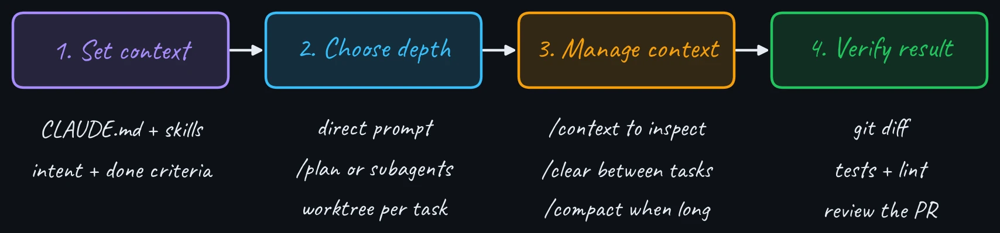{fig-align="center" fig-alt="Four-step mental model. 1, set context: CLAUDE.md and skills, intent and done criteria. 2, choose depth: direct prompt, /plan or subagents, a worktree per task. 3, manage context: /context to inspect, /clear between tasks, /compact when long. 4, verify result: git diff, tests and lint, review the PR."}

::: {.card-green .card-compact style="font-size:0.85em; margin-top:1em; text-align:center;"}
**Delegate the work, keep ownership of the result.**
:::

::: {.notes}
Summarise the four-step mental model:
1. Set context: Curate CLAUDE.md, provide clear intent and acceptance criteria.
2. Choose depth: Use direct prompts for small tasks, planning mode or subagents for complex work, and worktrees for parallel execution.
3. Manage context: Inspect token consumption with `/context`, clear between tasks, and compact when sessions run long.
4. Verify results: Inspect diffs, run test suites, and review changes with standard engineering rigour.
:::
## Resources {.smaller}

::: {style="font-size: 1.05em;"}

- [Claude Code official documentation](https://code.claude.com/docs/en/overview) — tools, skills, workflows, subagents, planning mode
- [Claude Code best practices](https://code.claude.com/docs/en/best-practices) — prompting patterns, guardrails, context management
- [Explore the context window](https://code.claude.com/docs/en/context-window) — interactive view of what loads and when
- [Anthropic's guide to agentic coding](https://www.anthropic.com/engineering/claude-code-best-practices) — ReAct loop, quality scaffolding, CLI vs MCP trade-offs

:::

::: {.notes}
Direct attendees to key documentation, including official guides, prompt engineering references, and Anthropic's agentic engineering publications.
:::
## Thank You

 

::: {style="text-align: center; font-size: 0.82em; color: #8b949e; margin-bottom: 1.2em;"}
Other [slide decks](https://www.indrapatil.com/presentations/) on software engineering practices
:::

::: {style="text-align: center; font-size: 1.1em;"}

<a class="deck-icon-link" href="https://www.linkedin.com/in/indrajeet-patil-ph-d-397865174/" aria-label="LinkedIn"></a>
&nbsp;&nbsp;&nbsp;
<a class="deck-icon-link" href="https://github.com/IndrajeetPatil" aria-label="GitHub"></a>
&nbsp;&nbsp;&nbsp;
<a class="deck-icon-link" href="mailto:patilindrajeet.science@gmail.com" aria-label="Email"></a>

:::

 

::: {.terminal-box style="max-width: 480px; margin: 0 auto;"}
<pre><code>$ claude --help
Claude Code — AI pair programmer
Use it well. Ship great software.
</code></pre>
:::

::: {.notes}
Conclude the presentation, thank the audience, and invite questions and discussion on practical agentic workflows.
:::
